# Azure-Cost-Visibility-Dashboard-with-Terraform
I built a system that watches an Azure subscription's spend, emails the owner at three budget thresholds, and shows subscription activity in a dashboard. Everything except the Logic App steps and the dashboard is built with Terraform.
 
### 🎬 Video Walkthrough
 
[Watch the project walkthrough](https://www.loom.com/share/67deff8d831b44449d8ab792ebd8b754)
 
 
---
 
### Result at a glance
 
| | |
|---|---|
| **What I built** | A monthly $10 budget with alerts at 25%, 50% and 100% ($2.50, $5 and $10), an email Action Group, a Logic App that sends a formatted alert email, a Log Analytics workspace, and an Azure Workbook |
| **Proof it works** | `terraform apply` created 6 resources, a second `terraform plan` reported "No changes", the Logic App sent a test email, and the Action Group test notification succeeded (screenshots 02, 04, 06, 12, 13) |
| **Cost to run** | `[FILL IN from Cost Management after teardown]` |
| **Cleanup** | `[FILL IN: terraform destroy output, resource group gone]` |
| **Tools** | Terraform, Azure Monitor, Cost Management, Logic Apps, Log Analytics, Azure Workbooks |
 
---
 
## Project Overview
 
### What this project does, in plain English
 
Think of it like a smoke detector for your cloud bill. The budget is the sensor. When spending crosses a line, the Action Group is the alarm that emails the owner, and the dashboard is where you look to see what changed.
 
Where the analogy breaks down: a smoke detector reacts to something happening right now. Azure cost data arrives with a delay of hours, so alerts can fire after the spend has already happened. Budgets also only notify. They do not stop spending.
 
### Why it matters
 
Cloud bills are full of line items like `Microsoft.Compute/virtualMachines` that a business owner cannot read or predict. The first FinOps habit is simple: know what you spend and get warned before the limit, not after.
 
### What gets built
 
| Component | Built with |
|---|---|
| Resource group `rg-cost-dashboard-<name>` | Terraform |
| Log Analytics workspace `law-cost-<name>` (30-day retention) | Terraform |
| Action Group `ag-cost-alerts-<name>` (email) | Terraform |
| Monthly budget `budget-cost-<name>`, $10, alerts at 25%, 50%, 100% | Terraform |
| Subscription activity log sent to Log Analytics | Terraform |
| Logic App `la-cost-alert-<name>` (container) | Terraform |
| Logic App steps (HTTP trigger, Gmail send email) | Portal designer |
| Dashboard (Workbook of subscription activity) | Azure Workbooks (portal) |
 
### Skills demonstrated
 
- Infrastructure as Code with Terraform on Azure
- Reading a saved `terraform plan -out` before applying it
- Detecting configuration drift and fixing it with `lifecycle { ignore_changes }`
- Azure Cost Management budgets and alert thresholds
- Azure Monitor Action Groups and Log Analytics (KQL)
- Low-code automation with Logic Apps
- Reading provider errors and fixing them (see Troubleshooting)
---
 
## Project Structure
 
```text
cost-dashboard-001/
├── README.md
├── versions.tf                  # Terraform and provider version rules
├── providers.tf                 # how Terraform connects to Azure
├── main.tf                      # the resources
├── variables.tf
├── outputs.tf
├── .terraform.lock.hcl          # pins the provider version
├── terraform.tfvars.example     # placeholders only
├── .gitignore                   # excludes terraform.tfvars, state, plans, .terraform/
└── images/                      # evidence screenshots
```
 
---
 
## Architecture Diagram


 
### How it works
 
1. **Budget.** A $10 monthly budget watches the subscription's actual spend.
2. **Alert.** At 25% ($2.50), 50% ($5) and 100% ($10), the budget fires a notification.
3. **Notify.** The Action Group emails the owner.
4. **Format.** The Logic App receives an HTTP request and sends a readable email through Gmail. I tested it by running it manually. Wiring the Action Group to call the Logic App is not done yet and is listed under next steps.
5. **Log.** The subscription activity log flows into Log Analytics so you can query who changed what.
6. **See.** An Azure Workbook charts that activity in the portal.
 
### Key terms
 
| Term | What it means |
|---|---|
| **Budget** | A spending limit with alert thresholds, set in Cost Management |
| **Action Group** | A reusable list of who or what gets notified when an alert fires |
| **Log Analytics** | Azure's central place to store and query logs |
| **Logic App** | Low-code workflow: when X happens, do Y |
| **Azure Workbook** | A reporting page inside Azure Monitor |
| **Terraform state** | Terraform's record of what it built. Never committed, it can hold secrets |
| **Drift** | When the real setup no longer matches the code, usually after a portal edit |
| **FinOps** | Managing cloud spend as an ongoing practice |
 
---
 
## Prerequisites
 
| Requirement | Version used |
|---|---|
| Azure subscription (active, Owner or Contributor) | Pay-as-you-go |
| Terraform | 1.16.6 (azurerm provider 4.81.0) |
| Azure CLI | `[FILL IN: az --version]` |
| An email address for alerts | any |
 
**Time and cost:** about 3 - 4 hours. Cost: `[FILL IN]`.
 
---
 
## Naming Conventions Used
 
| Item | Name |
|---|---|
| Resource group | `rg-cost-dashboard-<name>` |
| Log Analytics | `law-cost-<name>` |
| Action Group | `ag-cost-alerts-<name>` |
| Budget | `budget-cost-<name>` |
| Logic App | `la-cost-alert-<name>` |
 
---
 
## Project Steps
 
### Step 1: Create the folder and variables.tf
Six variables: `yourname`, `location` (East US), `alert_email`, `budget_amount`, `budget_start_date` and `tags`. The code is split into `versions.tf`, `providers.tf`, `main.tf`, `variables.tf` and `outputs.tf`. Terraform merges every `.tf` file in the folder, so the split is only for readability.
 
### Step 2: terraform.tfvars
Values for the required variables. This file stays out of Git. `terraform.tfvars.example` is committed with placeholders. I set `budget_amount = 10` so the alerts fire at $2.50, $5 and $10, which suits a pay-as-you-go account.
 
### Step 3: main.tf
Resource group, Log Analytics workspace, Action Group, subscription budget with three notifications, Logic App, and the diagnostic setting. **The budget start date must be the first day of the current or a future month**, so `budget_start_date` is a variable that is set before applying.
 
### Step 4: outputs.tf
Prints the resource group name, workspace ID, Action Group ID, budget name and Logic App name after apply.
 
### Step 5: Deploy
```bash
terraform init
terraform fmt
terraform validate
terraform plan -out=tfplan
terraform apply tfplan
```
Saving the plan with `-out` means `apply` does exactly what I reviewed. `tfplan` is in `.gitignore`.
 
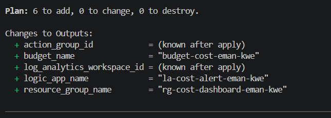
 
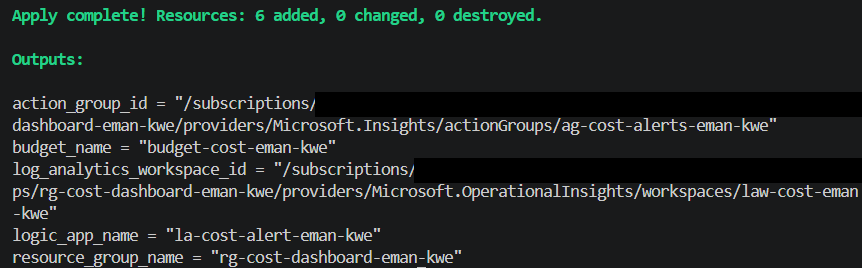
 
Three of the six resources show in the resource group. The budget and the diagnostic setting attach to the subscription, so they are not listed there.
 
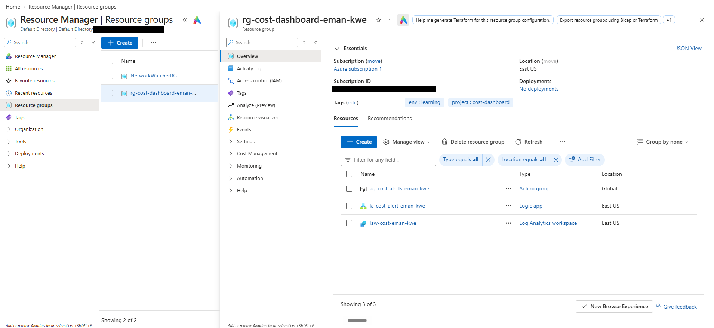
 
Running the plan a second time shows no differences, because the real setup already matches the code.
 
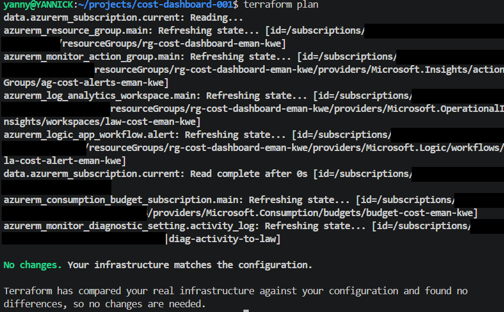
 
### Step 6: Configure the Logic App
Terraform creates only the empty Logic App. I built the **When a HTTP request is received** trigger and the **Gmail, Send email (V2)** action in the portal designer. The email step needs an interactive sign-in, so Terraform cannot do it. I used the Gmail connector because the Office 365 connector needs an Exchange Online mailbox.
 
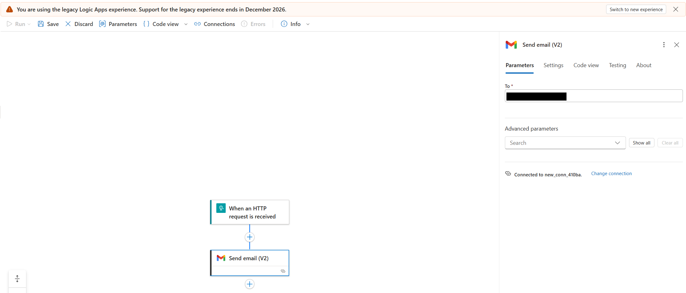
 
Running the Logic App delivered the email:
 
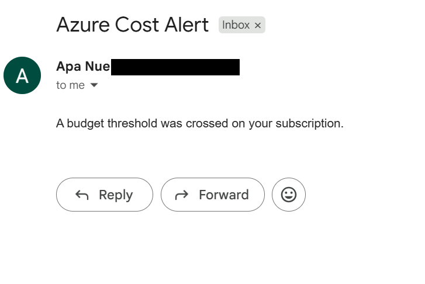
 
**Drift.** Signing in to Gmail stored a connection inside the Logic App that my code did not describe. The next `terraform plan` wanted to delete it:
 
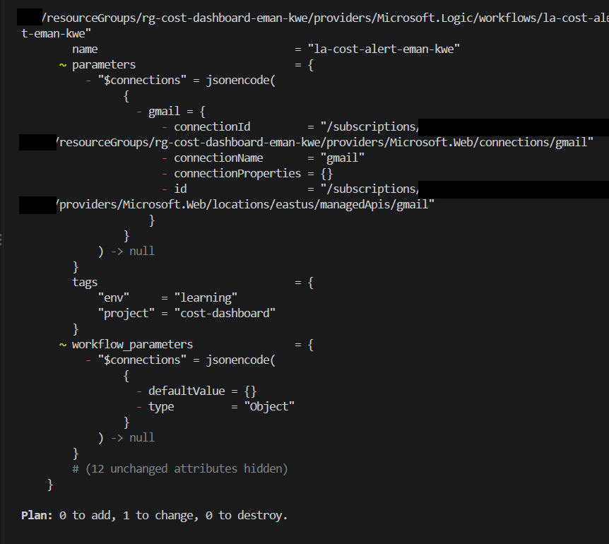
 
I did not apply. I added `lifecycle { ignore_changes = [parameters, workflow_parameters] }` to the Logic App resource, so Terraform keeps managing the Logic App but leaves the connection alone. The plan returned to "No changes":
 
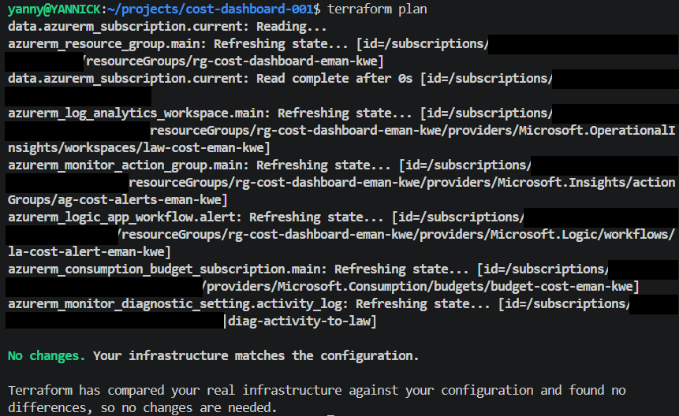
 
### Step 7: Build the dashboard
I created a Workbook in Azure Monitor, using the **Logs (Analytics)** data source against the Log Analytics workspace:
 
```kusto
AzureActivity
| where TimeGenerated > ago(24h)
| summarize Operations = count() by OperationNameValue
| top 10 by Operations desc
```
 
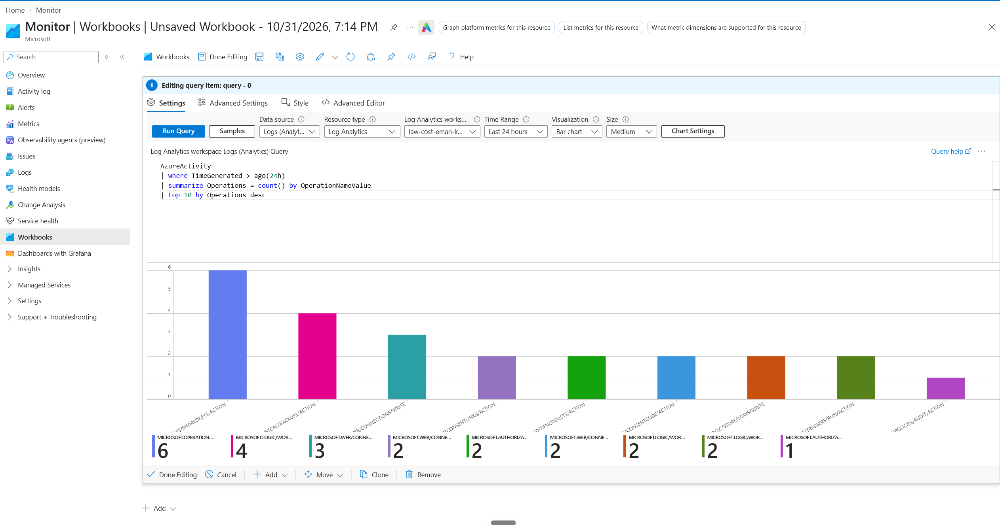
 
The saved dashboard charts subscription activity from the last 24 hours. It shows **activity, not dollars**. Spend by service lives in Cost Management, and charting real cost data here is a next step.
 
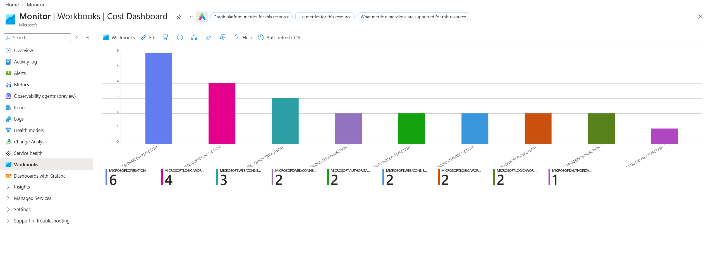
 
### Step 8: Test the alert
Budgets only fire on real spend, and mine stays near zero, so I tested the notification channel directly. The Action Group email receiver has to be **Verified** before the test works.
 
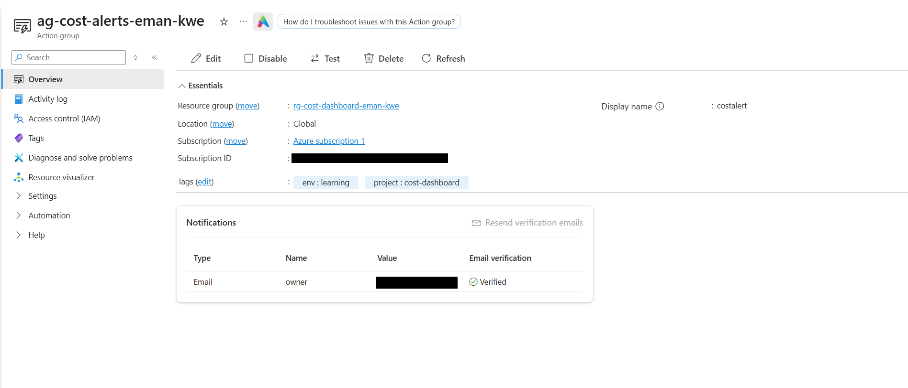
 
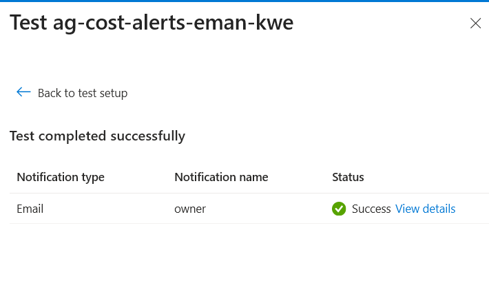
 
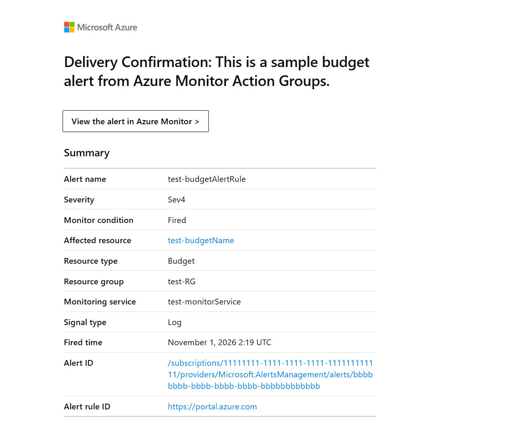
 
Both budgets as shown at the subscription scope:
 
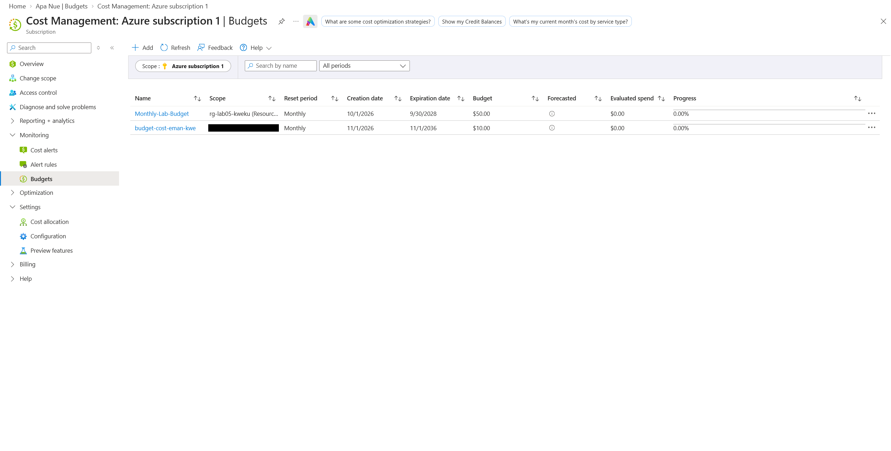
 
### Step 9: Tear everything down
```bash
terraform destroy
```
`[SCREENSHOT: destroy complete]` Then confirm the resource group is gone in the portal.
 
---
 
## Results
 
| Check | Result |
|---|---|
| Resource group created | ✅ Done |
| Budget visible in Cost Management → Budgets | ✅ Done (at subscription scope, screenshot 14) |
| Action Group exists | ✅ Done, email Verified |
| Logic App Enabled, trigger and email action in designer | ✅ Done |
| Log Analytics workspace exists | ✅ Done |
| Workbook saved | ✅ Done |
| Test notification received | ✅ Done (Logic App email and Action Group test) |
| Teardown verified | `[ ]` Not done yet |
 
---
 
## Security Decisions
 
- **Secrets and state out of Git.** `terraform.tfvars`, state files, saved plans and `.terraform/` are in `.gitignore`.
- **No subscription IDs or emails in screenshots.** They are blacked out and the final images were scanned for leftovers.
- **Scanned before the first commit.** Staged files were searched for my email and subscription ID.
- **Least privilege.** My account created every resource, including the budget, without an `AuthorizationFailed` error, so no extra role was needed.
- **Logic App URL never shown.** The HTTP trigger URL contains a secret key.
- **Short retention.** Log data is kept 30 days to limit cost and exposure.
- **Teardown the same day.**
---
 
## Troubleshooting / Common Issues
 
| Issue | Cause | Fix |
|---|---|---|
| Plan showed a $200 budget, not $10 | `budget_amount` was missing from `terraform.tfvars`, so the default was used | Add `budget_amount = 10` and re-plan |
| `BudgetStartDateInvalid` (caught before it happened) | Start date must be the first of the current or a future month | Update `budget_start_date` |
| Logic App trigger shows no POST URL | I picked the **HTTP** trigger, which calls an outside URL, instead of **When a HTTP request is received** | Delete it and add the request trigger |
| Subject and Body fields missing on Send email | They are under Advanced parameters | Click **Show all** |
| `terraform plan` wants to remove `$connections` | Gmail connection added in the portal, not in code (drift) | `lifecycle { ignore_changes = [parameters, workflow_parameters] }` |
| Workbook warns about extra cost | Data source was **Logs (Basic)** | Use **Logs (Analytics)** |
| Workbook query fails | The word `kusto` was copied from a code block label | Start the query at `AzureActivity` |
| Budget not visible in Cost Management | Wrong scope. Billing account, subscription and resource group show different budgets | Change scope to the subscription |
| Action Group test fails ("problem completing this test") | Email receiver still **Pending** verification | Resend the verification email, confirm it, retest |
 
---
 
## Key Takeaways
 
- Know your spend before you optimize it.
- Alerts need a test path. A budget alert may not fire for days, so test the notification channel directly.
- Cost data is delayed, so alerts are early warnings, not real-time controls.
- Read the plan before every apply. It caught a wrong budget amount and a change that would have deleted the email connection.
- Mixing portal edits with Terraform creates drift. Decide which tool owns what.
 
### What I would do next
 
- Define the Logic App trigger, connection and action in Terraform so nothing depends on the portal.
- Wire the Action Group to call the Logic App.
- Export Cost Management data to the workspace and chart dollars, not only activity.
- Use remote state with locking, and a pipeline that runs `plan` on pull requests.
---
 
## Reference
 
- [Azure Cost Management budgets](https://learn.microsoft.com/azure/cost-management-billing/costs/tutorial-acm-create-budgets)
- [Azure Monitor Action Groups](https://learn.microsoft.com/azure/azure-monitor/alerts/action-groups)
- [Terraform azurerm provider](https://registry.terraform.io/providers/hashicorp/azurerm/latest/docs)
---
 
**Author:** Manuel Yannick Armah
 
**Project:** Azure Cost Visibility Dashboard with Terraform
 
**Difficulty:** Beginner
 
**Time to Complete:** 3 - 4 hours
